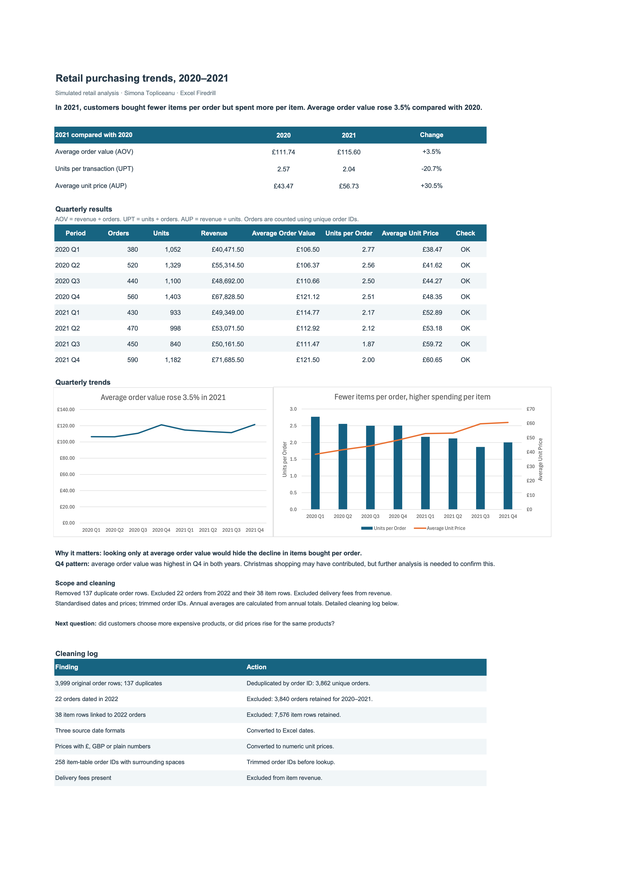

# Retail purchasing trends: Excel analysis

An individual training project completed during the iO-Sphere Data Analytics bootcamp, using simulated retail data.

## Business question

How did average order value, units per transaction and average unit price change across the eight quarters of 2020 and 2021?

The stakeholder requested an Excel summary with quarterly KPIs, two charts and a short explanation of the findings.

## Summary

## Key findings

Compared with 2020, in 2021:

- **Average order value increased by 3.5%**, from £111.74 to £115.60.
- **Units per transaction decreased by 20.7%**, from 2.57 to 2.04.
- **Average unit price increased by 30.5%**, from £43.47 to £56.73.

Customers bought fewer items per order, but spent more per item. Looking only at average order value would hide this change in purchasing behaviour.

## Approach

- Used Power Query to standardise date and price formats and trim spaces from order IDs.
- Removed 137 duplicate order rows.
- Excluded 22 orders from 2022 and their 38 associated item rows.
- Linked order dates to item records using XLOOKUP.
- Used a PivotTable and formulas to summarise orders, units and revenue by quarter.
- Calculated the three KPIs and created two charts.
- Documented cleaning decisions and excluded delivery fees from revenue.

The final analysis covers **3,840 orders and 7,576 item rows**.

## Calculations and validation

- **AOV:** revenue ÷ unique orders.
- **UPT:** units sold ÷ unique orders.
- **AUP:** revenue ÷ units sold.

I checked that AOV equals UPT × AUP using unrounded values. Annual KPIs were calculated from annual totals, rather than averaging quarterly ratios.

## Limitations and next question

A higher average unit price does not necessarily mean individual product prices increased. Customers may have bought a different mix of products.

My next step would be to compare product-level prices and sales mix across the two years.

## What I learned

Counting item rows is different from counting unique orders. I also learned to keep full precision in calculations and round only the displayed results.

The portfolio version was refined after the timed exercise to improve validation and presentation.

## Workbook and source files

- [Excel workbook](retail-sales-analysis.xlsx)
- [Orders source data](Orders.csv)
- [Items sold source data](Items_sold.csv)

The workbook includes the summary, Power Query cleaning steps,
cleaned data, PivotTable and cleaning log. Saved results can be
reviewed without refreshing.

### Refreshing the workbook

1. Download the workbook and both source CSV files.
2. Open the workbook in Excel.
3. In Power Query, update each query’s Source step to point to
   the corresponding CSV on your computer.
4. Refresh the queries, then refresh the PivotTable.

The saved source paths originally pointed to files on my computer.
If you see a `DataSource.NotFound` error, update these paths.
The cleaning steps do not need to be recreated.

**Tools:** Excel, Power Query, XLOOKUP, PivotTables, formulas and charts.
